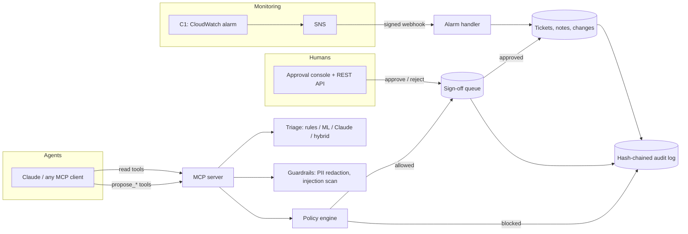

# OpsWatch

**AI-assisted IT service desk triage, exposed to AI agents through MCP, where the AI can propose anything and a human approves everything.**

An agent (Claude Desktop, Claude Code, or any MCP client) can search tickets, triage them, look up runbooks and propose fixes. Every change it proposes lands in a sign-off queue. A policy engine decides how risky each proposal is and who may approve it. Every step goes into a tamper-evident audit log. CloudWatch alarms from the companion [C1 serverless project](docs/C1_INTEGRATION.md) arrive as incidents automatically.

> **Status:** complete and tested offline (114 tests, 93% coverage). The rules and ML baselines are fully evaluated. The Claude (LLM) evaluation runs as soon as an `ANTHROPIC_API_KEY` is set; its results are not claimed until then.

## The problem

Service desks drown in tickets that someone has to read, categorize, prioritize and route before any work starts. AI can do that first pass, but letting an AI act directly on production systems is how you get an agent that closes every ticket because an email told it to. OpsWatch is built around that tension: **useful automation without giving the model the keys.**

## How it works



### The safety model

| Layer | What it does |
|---|---|
| **Tool design** | Read tools are marked read-only. Write tools only *propose*. **There is no approve tool**, so no prompt can make the agent approve its own work. |
| **Policy engine** (`config/policy.toml`) | Assigns risk per action; blocks agents from resolving P1 or security incidents; enforces change-freeze windows; rate-limits proposals per agent; caps open proposals per ticket. |
| **Separation of duties** | The proposer can never approve. Agents can never approve. High-risk actions need a senior approver. |
| **Untrusted input handling** | Ticket text is wrapped and labeled as untrusted; PII (emails, phones, SINs, Luhn-valid card numbers) is redacted before any LLM sees it; a prompt-injection scanner flags suspicious tickets and forces every proposal on them to high risk. |
| **Structured LLM output** | Claude must answer through a forced tool call with enum-constrained fields; output is re-validated; any failure falls back to the rules triager. Priority is computed from the ITIL impact x urgency matrix in code, not chosen by the model. |
| **Audit log** | Each entry stores the hash of the previous one. Editing or deleting any past entry is detected by `opswatch audit-verify`. |

Full mapping to the OWASP Top 10 for LLM Applications: [docs/OWASP_LLM_TOP10.md](docs/OWASP_LLM_TOP10.md).

## Results

All numbers are generated by `opswatch eval` into [reports/EVALUATION.md](reports/EVALUATION.md). The test set is **240 synthetic tickets built from different templates and different phrasings than the training set**, so memorizing training sentences doesn't help.

| Triager | Category accuracy | Macro-F1 | Priority accuracy | Priority within one level | p50 latency |
|---|---|---|---|---|---|
| Rules (keywords) | 57.1% | 0.563 | 43.3% | 74.6% | 0.03 ms |
| ML (TF-IDF + logistic regression) | 57.5% | 0.574 | 35.8% | 75.8% | 3.5 ms |
| Claude | *pending API key* | | | | |
| Hybrid (rules first, uncertain to Claude) | *pending API key* | | | | |

**Human-review threshold (rules):** at confidence 0.6, 65.4% of tickets are auto-suggested at 79.0% accuracy; the rest go to a person.

**Prompt-injection detector** (54 labeled examples): recall 1.0, precision 0.889, false-positive rate 2.2%. The one false positive ("the system prompt on the kiosk says press any key") is listed in the report.

**What these numbers mean:** both cheap baselines land around 57% on phrasings they've never seen. That gap is the case for the LLM, and it's why the hybrid design only pays for Claude on uncertain tickets. An earlier version showed 74.6% for rules; that was leakage (keywords copied from test phrasings), found and removed. A test now enforces that the rules vocabulary comes from training data only. Details in [NOTES.md](NOTES.md#decisions).

## Quickstart

```bash
pip install -e ".[dev]"
opswatch demo          # 2-minute scripted walkthrough, in memory, no API key needed
opswatch eval --gate   # regenerate reports/EVALUATION.md; non-zero exit on regression
pytest                 # 114 tests
```

**Run it for real (two terminals, one shared database):**
```bash
export OPSWATCH_API_KEY=$(python -c "import secrets; print(secrets.token_urlsafe(24))")
opswatch serve-api     # approval console at http://127.0.0.1:8000
opswatch serve-mcp     # MCP server over stdio (normally launched by your MCP client)
```
Connect Claude Desktop or Claude Code: [docs/MCP_CLIENT_SETUP.md](docs/MCP_CLIENT_SETUP.md).

**Use Claude for triage:** set `ANTHROPIC_API_KEY` and `OPSWATCH_TRIAGER=hybrid`, then `opswatch eval --triagers rules,llm,hybrid --llm-limit 120` to measure it.

**Docker:** `docker build -t opswatch . && docker run -e OPSWATCH_API_KEY=... -p 8000:8000 opswatch`

## MCP tools

| Tool | Type | Purpose |
|---|---|---|
| `search_tickets` | read | Find tickets by text, state or category |
| `get_ticket` | read | Ticket with PII redacted, work notes, existing proposals |
| `triage_ticket` | read | Category, priority, group, confidence, KB articles, review flags. Changes nothing |
| `search_knowledge_base` | read | Runbooks and how-to articles |
| `list_my_proposals` | read | Status of the agent's proposals |
| `propose_ticket_update` | propose | Category / priority / state |
| `propose_work_note` | propose | Investigation notes |
| `propose_resolution` | propose | High risk; blocked for P1 and security |
| `propose_change_request` | propose | Needs implementation + rollback plans; blocked in freeze windows |
| `opswatch://policy` | resource | The policy the agent operates under |

## Quality gates

| Check | Result |
|---|---|
| Tests | 114 passing (policy, workflow, guardrails, triage with a fake Claude client, MCP, REST API, SNS signatures, eval, CLI, demo) |
| Coverage | 93% |
| Lint | ruff clean |
| Eval gate | CI fails if accuracy or injection detection drops below `config/eval_gate.toml` |
| Leakage guard | CI fails if the rules vocabulary uses words not found in training data |
| Live checks (done during build) | Real MCP client over stdio proposed a change; a human approved it through the running REST API; audit chain verified |
| Container | Built locally from `Dockerfile` and smoke-tested: `/health` returns `{"status":"ok"}`, `/api/metrics` returns 200 with a correct `X-API-Key` and 401 without one, and the process runs as non-root uid 10001. Also built and smoke-tested in CI. |

## Project layout

```
src/opswatch/
  mcp_server.py        MCP tools (read + propose-only)
  api.py               REST API + approval console (human side)
  actions.py           propose -> policy -> pending -> approve -> execute
  guardrails/          policy engine, PII redaction, injection scanner
  triage/              rules, ML, Claude, hybrid; triage service with review routing
  integrations/        SNS signature verification, CloudWatch alarm handler (C1 bridge)
  audit.py             hash-chained audit log
  store.py             SQLite mock ITSM (incidents, changes, KB, approvals)
  evaluation/run.py    offline eval + CI gate
  seed.py              labeled synthetic dataset + 20 KB articles/runbooks
  severity.py          alarm severity policy shared by seed, rules and webhook
config/                policy.toml, eval_gate.toml, pricing.toml
docs/                  OWASP mapping, C1 integration, MCP setup, use cases
NOTES.md               learning guide and interview prep
```

## Limitations and next steps

- **Synthetic data.** Realistic, labeled and held out properly, but not real tickets. Real-world accuracy must be measured on real data.
- **Claude results not yet measured** here (no API key in the build environment). Run the LLM eval before quoting any LLM number.
- **Confidently wrong cases exist.** Example from the demo: "Credential harvesting attempt" is triaged as access, not security, at confidence 1.0, so the review threshold doesn't catch it. The approval gate does. Next step: always escalate when any security term appears.
- **Approver identity comes from the request body** behind an API key. Production would use SSO (OIDC) and take identity from the token.
- **SQLite** is single-node. Postgres would be the next step; only `store.py` touches SQL.
- **Injection scanning is regex-based.** It's a first layer; the structural guarantee (no approve tool, human sign-off) is what actually protects the system.
- **KB search is TF-IDF.** Embeddings plus a vector store would handle paraphrases better at scale.
- **Latency numbers are machine-dependent.** The p50 figures above come from one run on one machine; treat them as orders of magnitude, not benchmarks.
- **The local container check used host networking.** The image was built from the unmodified `Dockerfile` and verified, but the sandbox it was verified in blocks bridge networking and intercepts TLS, so the build needed a throwaway CA layer and the container was run with `--network host` instead of `-p 8000:8000`. Neither workaround is in the committed `Dockerfile`; the published image is what CI builds. Port publishing itself is therefore only exercised in CI.
