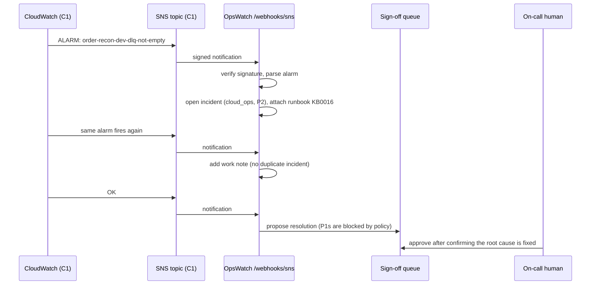

# Bridge to C1: serverless alarms become service desk incidents

C1 (the order-payment reconciliation service on AWS) already sends CloudWatch alarms to an SNS topic. Point that topic at OpsWatch and every alarm becomes a triaged incident with the right runbook attached.

## Flow



## Severity policy

Alarms don't say "I can't work", so priority comes from `src/opswatch/severity.py`:

| Alarm contains | Impact, urgency | Priority |
|---|---|---|
| `5xx`, `502`, `503` (customers see errors) | 1, 1 | P1 |
| `dlq`, `dead-letter`, `errors`, `timing out` (data failing) | 2, 1 | P2 |
| `backlog`, `throttl` (slow, not failing) | 2, 2 | P3 |
| `report`, `did not run` (internal job) | 3, 2 | P4 |
| `budget` | 3, 3 | P4 |

## Setup

1. Deploy OpsWatch somewhere with HTTPS (container on ECS Fargate, App Runner, or any host behind TLS). Keep `OPSWATCH_SNS_VERIFY=true`.
2. Add this to C1's `infra/monitoring.tf`:

```hcl
variable "opswatch_webhook_url" {
  description = "Public HTTPS URL of OpsWatch's /webhooks/sns endpoint"
  type        = string
  default     = ""
}

resource "aws_sns_topic_subscription" "opswatch" {
  count     = var.opswatch_webhook_url == "" ? 0 : 1
  topic_arn = aws_sns_topic.alerts.arn
  protocol  = "https"
  endpoint  = var.opswatch_webhook_url
}
```

3. `terraform apply`. SNS sends a `SubscriptionConfirmation`. OpsWatch deliberately does **not** auto-confirm; it returns the `SubscribeURL`. Open that URL once to confirm. This stops anyone from subscribing your webhook to a topic you don't control.

## Why the webhook can set category and priority directly

Human-written tickets always go through proposals, because their text is untrusted. Alarm notifications are machine data whose origin is proven by the SNS signature, and their severity follows a fixed policy table. That's the line between trusted and untrusted inputs.

## Signature verification

`integrations/sns.py` rebuilds the canonical string SNS signs, downloads the signing certificate only from `https://sns.<region>.amazonaws.com/...pem`, and verifies with SHA1 (SignatureVersion 1) or SHA256 (SignatureVersion 2). Tests generate a real RSA key and certificate to check that valid messages pass and tampered ones fail.
